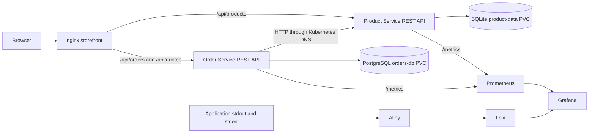
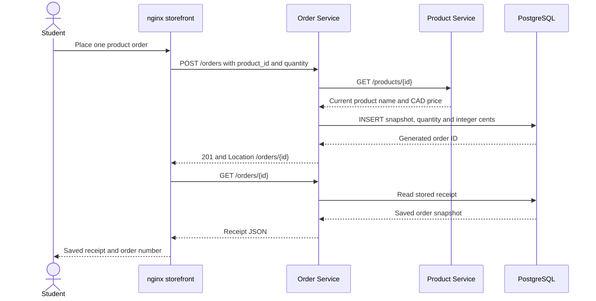

# Campus Bookstore architecture

Product Service owns the SQLite catalog. Order Service owns PostgreSQL orders and
obtains product data through HTTP. Neither API reads the other's database.
nginx serves the browser application and acts as a same-origin API gateway.

## Deployment environments

| Environment | Website | Persistence | Monitoring |
| --- | --- | --- | --- |
| Docker Compose demo | localhost:3000 | Compose named volumes | Docker logs; separate from Kubernetes |
| Kubernetes final demo | localhost:3002 through port-forward | Existing SQLite and PostgreSQL PVCs | Prometheus, Grafana, Loki, Alloy |
| Automated tests | localhost:3100 | Separate Compose project and volumes | Test output; no demo data writes |

Kubernetes Services provide DNS discovery. Order Service is stateless and scales
from one to three replicas through CPU HPA. A single Product Service replica uses
SQLite on a ReadWriteOnce PVC and a Recreate strategy. This is an explicit local
demo tradeoff; scaling Product Service would need a shared database design.
Order Service uses RollingUpdate with maxUnavailable=0 and maxSurge=1.

## Security boundaries

The applications run without root. Database credentials come from environment
variables or an existing Kubernetes Secret, never from committed plaintext.
Application pods do not mount Kubernetes API tokens. A separate read-only RBAC
example permits pod listing and rejects pod deletion. The API gateway limits
requests to 20/second per client address with a burst of 100, returning 429 above
that allowance. This supplements but does not replace authentication.

NetworkPolicies permit storefront-to-API traffic, Order-to-Product traffic,
Order-to-PostgreSQL traffic and monitoring-to-API scrapes. Product-to-PostgreSQL
and Product-to-Order connections are denied. On this Docker Desktop cluster,
the pinned kube-router controller enforces policy in firewall-only mode. It does
not replace kube-proxy, enable routing or change CNI configuration. The controller
requires privileged node access; application containers do not.

## Observability

Each API exposes bounded-label request counts and response-time histograms.
Labels use the route template rather than product/order IDs, query strings or
user input. One Gunicorn worker with four threads runs per pod, and Kubernetes
scales pods. Prometheus ServiceMonitors discover both APIs. Grafana provisions
the Campus Bookstore dashboard, combining numeric metrics and centralized logs.
Liveness checks the process; readiness queries the service's own database table.

## Limits

This coursework demo has no authentication, payments, server-side idempotency or
multi-item cart. It uses localhost access. HPA, NetworkPolicy and rolling updates
must be demonstrated with actual checks; a YAML file alone is not evidence.
Monitoring storage remains a local demo configuration: Loki has a PVC, while
Prometheus metrics and Grafana runtime state are ephemeral. The dashboard itself
is reproducible from its committed ConfigMap. Alert notifications are disabled.
